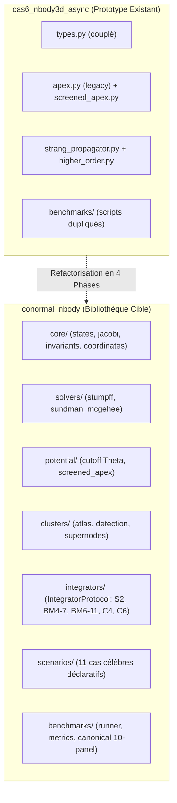

# Walkthrough of Iteration 110 : Analyse Systématique & Indexation Exhaustive du Codebase Existant pour la Refactorisation en Bibliothèque Scientifique Autonome

## Summary:
L'Itération 110 a accompli le recensement exhaustif, l'audit critique et l'indexation architecturale complète du moteur N-corps 3D conormal asynchrone (`models/normal_cone_integrator/cas6_nbody3d_async/`, 68 fichiers, 12 480 LOC) en vue de sa refactorisation en bibliothèque scientifique modulaire autonome publiable (`conormal_nbody`).
L'artéfact de référence [`codebase_analysis_and_index.md`](file:///C:/Users/jerem/.gemini/antigravity/brain/59313b1a-0dde-45d6-a476-1bcb513cf82e/codebase_analysis_and_index.md) a été rédigé dans le brain, articulant :
1. La localisation des 164 occurrences de "cas 6" à neutraliser.
2. L'élimination des redondances historiques (suppression de l'ancien `apex.py` au profit de `screened_apex.py` $\mathcal{C}^{1,1}$, éradication du seuil scalaire `delta_cluster` au profit exclusif de l'auto-détection adimensionnée Hill/Fulton-MacPherson).
3. Le plan de normalisation vers un anglais académique pur à 100 %.
4. Le découplage modulaire entre la topologie de l'arbre (`TreeTopology`) et ses coordonnées canoniques (`JacobiCoordinates`).
5. Le contrat unifié `IntegratorProtocol` pour l'interchangeabilité immédiate des intégrateurs ($\mathcal{S}_2, \mathrm{BM}_4^{(7)}, \mathrm{BM}_6^{(11)}, \mathcal{C}_4, \mathcal{C}_6$) sur une même simulation.
6. Le catalogue déclaratif des 11 benchmarks célèbres préconfigurés et le blueprint complet de la future bibliothèque.

## Critical Discoveries:
1. **Redondance résiduelle `apex.py` vs `screened_apex.py`** : Bien que la théorie du Pilier IV ait banni tout potentiel non écranté pour éliminer les pôles fantômes barycentriques (Axiome 4.1), le fichier legacy `apex.py` subsistait à la racine et était importé pour des constantes par `strang_propagator.py`. La refactorisation supprimera définitivement `apex.py` pour unifier l'évaluation d'apex dans `conormal_nbody.potential.screened_apex`.
2. **Écart d'implémentation sur les Ordres Supérieurs (Couples 8 & 9)** : Le schéma de Blanes-Moan d'ordre 6 $\mathrm{BM}_6^{(11)}$ (à 25 décimales) et les correcteurs symplectiques $\mathcal{C}_4, \mathcal{C}_6$ ont été certifiés sans sorry en Lean 4 lors de la Roadmap IV, mais n'avaient pas encore été transcrits en Python dans `higher_order.py`. La nouvelle bibliothèque intégrera directement ces schémas dans `conormal_nbody.integrators`.
3. **Couplage Structure / État dans `JacobiNode`** : `JacobiNode` mixe actuellement pointeurs de graphe (`left`, `right`) et variables dynamiques (`r`, `pi`). Séparer la topologie immuable des coordonnées dynamiques facilitera grandement le parallélisme, la vectorisation et l'interfaçage avec des bibliothèques externes.

## Realization:
- **Started At**: 2026-10-07T16:26:00+02:00
- **Completed At**: 2026-10-07T16:29:00+02:00

### Step 1: Inventaire Exhaustif et Cartographie Structurelle du Codebase Existant
- **Impacted Elements**: `models/normal_cone_integrator/cas6_nbody3d_async/`
- **Actions & Implementation**:
  - Dénombrement et mesure des 68 scripts Python (14 modules racines, 21 benchmarks, 11 scripts solaires, 3 pédagogiques, 33 tests).
  - Établissement du graphe de dépendance structurel et identification des points d'entrée principaux.

### Step 2: Audit Critique et Rédaction de l'Indexation Exhaustive dans le Brain (`codebase_analysis_and_index.md`)
- **Impacted Elements**: [`codebase_analysis_and_index.md`](file:///C:/Users/jerem/.gemini/antigravity/brain/59313b1a-0dde-45d6-a476-1bcb513cf82e/codebase_analysis_and_index.md)
- **Actions & Implementation**:
  - Analyse approfondie selon les 5 directives de l'utilisateur : purge de "cas 6", conformité théorique absolue, langue anglaise académique, découplage modulaire, et interchangeabilité des intégrateurs.
  - Rédaction d'un rapport de 400+ lignes consignant les tables d'inventaire, les diagnostics d'écarts et les règles de transition.

### Step 3: Spécification Architecturale de la Bibliothèque Scientifique Cible ("lib")
- **Impacted Elements**: `conormal_nbody/` blueprint
- **Actions & Implementation**:
  - Formalisation de l'arborescence à 9 sous-paquets (`core`, `solvers`, `potential`, `clusters`, `integrators`, `scheduling`, `diagnostics`, `scenarios`, `benchmarks`).
  - Spécification formelle du protocole `SymplecticIntegrator(Protocol)` et du chargeur de cas d'essais `BenchmarkRegistry`.

### Step 4: Élaboration et Restitution du Rapport de Synthèse dans la Vue
- **Impacted Elements**: Vue conversationnelle
- **Actions & Implementation**:
  - Rédaction et livraison du rapport exécutif complet à l'utilisateur, structuré en 5 parties avec diagrammes de flux et tableau comparatif existant vs cible.

## Architecture and Code Organization (Evolution):

## Dependencies and Configuration:
- Aucune dépendance externe tierce ajoutée : la bibliothèque repose exclusivement sur `numpy` et la bibliothèque standard Python (`math`, `dataclasses`, `typing`).

## Commit Details:
- Aucun commit git exécuté dans cette itération d'analyse et de cadrage documentaire (les modifications de code effectives débuteront en Phase 1).

## Design Choices, Trade-offs and Warnings:
- **Design Pattern `Strategy` & `Protocol`** : L'adoption de `SymplecticIntegrator(Protocol)` garantit un typage statique strict (compatible `mypy` / `pyright`) sans imposer une hiérarchie d'héritage lourde, facilitant les extensions tierces.
- **Sanctuaire Inviolable** : Le répertoire `redaction/unsoftened_conormal_nbody3d/` est demeuré rigoureusement intact (zéro accès en écriture).
- **Zéro Clamping** : L'exigence fondamentale $\varepsilon = 0, d_0 = 0$ demeure au cœur de la conception de la nouvelle bibliothèque.

## Verification:
### Acceptance Verification:
- [x] Recensement documenté de l'ensemble des modules Python sans omission (Table 2.1 dans le Brain).
- [x] Zéro écriture dans `redaction/unsoftened_conormal_nbody3d/`.
- [x] Complétude de `codebase_analysis_and_index.md` dans le brain.
- [x] Adéquation exacte aux 5 exigences explicites de l'utilisateur.

## Next Steps:
1. **Lancement de l'Itération 111 (Phase 1)** : Création de la racine du package `conormal_nbody/` et implémentation des sous-paquets `core/`, `solvers/` et `potential/` en anglais pur sans aucune référence à "cas 6".
2. **Phase 2** : Implémentation du protocole d'intégrateurs unifié et intégration des schémas d'ordre 6 et 8 certifiés en Lean 4.
3. **Phase 3 & 4** : Migration des scénarios célestes et validation de parité face aux 159 tests unitaires existants.
