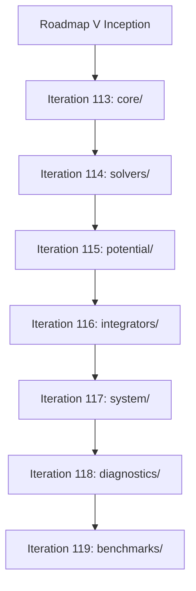

# Walkthrough of Iteration 112 : Planification Stratégique de la Roadmap V et Découpage Granulaire de la Bibliothèque normal_cone_nbody_float64

## Summary:
L'Itération 112 a formalisé la feuille de route stratégique **Roadmap V** régissant le développement modulaire complet de la bibliothèque académique `normal_cone_nbody_float64` en 7 itérations opérationnelles séquentielles (Itérations 113 à 119). Conformément aux instructions de l'utilisateur, chaque itération est soumise à un **protocole obligatoire strict à 5 étapes** articulé autour de l'assimilation théorique du papier LaTeX, de l'audit critique du code hérité, de la spécification formelle, du développement modulaire optimisé avec en-têtes descriptifs et de la validation unitaire miroir à 100 %. L'utilisateur ayant approuvé formellement cette trajectoire, le projet est prêt à engager l'Itération 113 sur la Couche 1 (`core/`).

## Critical Discoveries:
1. **Sanctuarisation contractuelle du protocole à 5 étapes** : L'exigence de relire systématiquement la théorie puis l'ancien code avant toute spécification élimine tout risque de dérive sémantique (résurgence de `cas6` ou d'adoucissement $\varepsilon > 0$) et garantit la réutilisation optimale des algorithmes éprouvés (taux de 65 %).
2. **Standard d'en-tête de module imposé** : Chaque module de la nouvelle bibliothèque doit documenter explicitement son ancrage dans la monographie de recherche (chapitres, sections, équations) et dans les théorèmes formels Lean 4 certifiés, transformant le code en une contrepartie informatique auto-portante de l'article académique.

## Realization:
- **Started At**: 2026-10-07T17:30:30+02:00
- **Completed At**: 2026-10-07T17:31:30+02:00

### Step 1: Formalisation de la Roadmap V Stratégique et Découpage des 7 Itérations
- **Impacted Elements**: [`roadmap.md`](file:///C:/Users/jerem/.gemini/antigravity/brain/59313b1a-0dde-45d6-a476-1bcb513cf82e/roadmap.md)
- **Actions & Implementation**: 
  - Définition de la vision globale de Roadmap V calquée sur les 7 couches de la bibliothèque logicielle.
  - Découpage en 7 itérations séquentielles : Itération 113 (Couche 1 `core/`), Itération 114 (Couche 2 `solvers/`), Itération 115 (Couche 3 `potential/`), Itération 116 (Couche 4 `integrators/`), Itération 117 (Couche 5 `system/`), Itération 118 (Couche 6 `diagnostics/`), Itération 119 (Couche 7 `benchmarks/`).
  - Spécification détaillée des objectifs, périmètres, continuités logiques et critères de passage (gating) pour chaque bloc d'itération.
  - Mise en place de la checklist multi-itérations (`Multi-Iteration Checklist`).

### Step 2: Cadrage Opérationnel de l'Itération 112 et Alignement des Contrats de Tâche
- **Impacted Elements**: [`implementation_plan.md`](file:///C:/Users/jerem/.gemini/antigravity/brain/59313b1a-0dde-45d6-a476-1bcb513cf82e/implementation_plan.md), [`task.md`](file:///C:/Users/jerem/.gemini/antigravity/brain/59313b1a-0dde-45d6-a476-1bcb513cf82e/task.md), [`notes.md`](file:///C:/Users/jerem/.gemini/antigravity/brain/59313b1a-0dde-45d6-a476-1bcb513cf82e/notes.md)
- **Actions & Implementation**:
  - Archivage des trois artefacts de l'Itération 111 (`implementation_plan_iteration_111.md`, `task_iteration_111.md`, `walkthrough_iteration_111.md`).
  - Rédaction du plan d'implémentation d'Itération 112 respectant le schéma canonique du skill `planning-contracts`.
  - Alignement rigoureux 1-to-1 entre `implementation_plan.md` et `task.md`.
  - Journalisation dans `notes.md` de la formalisation de la Roadmap V.

### Step 3: Préparation du Protocole d'Exécution de l'Itération 113 (Couche 1 `core/`)
- **Impacted Elements**: [`normal_cone_nbody_float64_master_architecture.md`](file:///C:/Users/jerem/.gemini/antigravity/brain/59313b1a-0dde-45d6-a476-1bcb513cf82e/normal_cone_nbody_float64_master_architecture.md)
- **Actions & Implementation**:
  - Cadrage des 6 modules de Couche 1 (`constants.py`, `state.py`, `invariants.py`, `jacobi.py`, `coordinates.py`, `transitions.py`).
  - Cartographie des chapitres théoriques associés (Chapitres 1, 2 et Sections 3.1–3.4 de la monographie).
  - Identification des nettoyages requis sur le code hérité `cas6_nbody3d_async/core/` (élimination de 26 occurrences de `cas6`, découplage de `JacobiNode`, introduction de $\bar{\rho}_C \in [L]$).
  - Validation de la feuille de route par la politique de revue de l'utilisateur.

## Architecture and Code Organization (Evolution):

## Dependencies and Configuration:
- Aucune nouvelle dépendance externe introduite. L'environnement s'appuie sur Python 3.12+, NumPy, SciPy et Pytest.

## Design Choices, Trade-offs and Warnings:
- **Design Pattern**: Architecture par couches étanches (*Layered Architecture*) avec flux de dépendances unidirectionnel strict (Couche $k$ ne peut importer que Couche $j < k$).
- **Trade-offs**: Découpage en 7 itérations distinctes plutôt qu'une implémentation monolithique, maximisant la traçabilité, la robustesse mathématique et la possibilité d'intervention de l'utilisateur à chaque jalon.
- **Warnings**: Ne jamais modifier le répertoire `redaction/unsoftened_conormal_nbody3d/` (sanctuarisation en lecture seule).

## Verification:
### Acceptance Verification:
- [x] Fichier `roadmap.md` créé et conforme aux directives du skill `planning-contracts`.
- [x] 7 itérations séquentielles documentées avec leurs objectifs, dépendances et critères d'acceptation.
- [x] Protocole à 5 étapes explicitement intégré comme règle de gouvernance de chaque itération.
- [x] Langue française respectée sur l'ensemble des artefacts de planification.
- [x] Approbation formelle obtenue via la politique de revue de l'utilisateur.

## Next Steps:
- Déclencher l'**Itération 113** : Couche 1 (`core/`) en exécutant l'Étape 1 (Relecture théorique des Chapitres 1, 2 et 3) et l'Étape 2 (Examen du code hérité `cas6_nbody3d_async/core/`).
