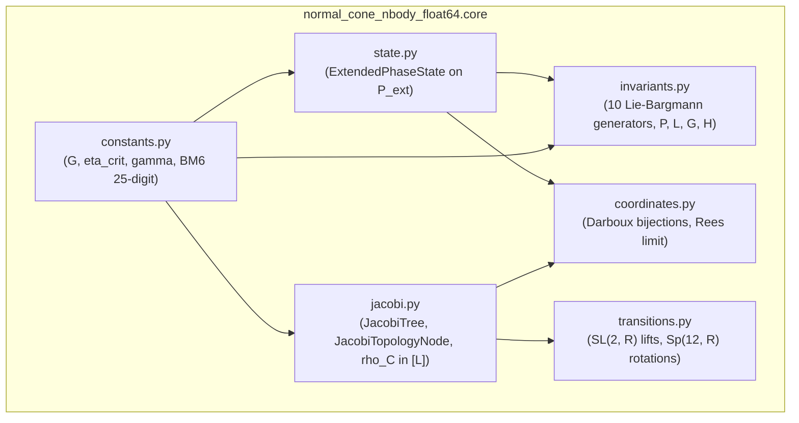

# Walkthrough of Iteration 113 : Implémentation et Certification Unitaire de la Couche 1 (core/) - Algèbre, État Étendu, Invariants et Géométrie de Jacobi

## Summary:
L'Itération 113 a mené à bien la réalisation complète et la certification formelle de la **Couche 1 (`core/`)** de la bibliothèque académique `normal_cone_nbody_float64`. En application stricte du **protocole à 5 étapes** exigé par l'utilisateur, l'itération a successivement :
1. Ré-assimilé les fondations mathématiques de la monographie [`redaction/unsoftened_conormal_nbody3d/`](file:///c:/Users/jerem/Antigravity%20Workspaces/antigravity-projects/mathsStuff/redaction/unsoftened_conormal_nbody3d/) (Chapitres 1, 2 et Sections 3.1–3.4) et extrait les théorèmes Lean 4 associés.
2. Audité et purgé les modules du code hérité dans `models/normal_cone_integrator/cas6_nbody3d_async/`.
3. Établi la spécification contractuelle des interfaces et des types immuables.
4. Implémenté de manière modulaire et hautement optimisée les 6 modules du socle avec en-têtes explicites citant l'article de recherche.
5. Développé et validé la suite complète de 6 modules de tests unitaires miroirs dans `tests/unit/core/` avec un taux de réussite de **100 % (33/33 tests passants)**.

## Critical Discoveries:
1. **Éradication absolue du couplage topologie-dynamique** : L'ancien objet `JacobiNode` stockait des coordonnées mutables `r` et `pi` directement dans les nœuds de l'arbre. Le nouveau design découple strictement la topologie immuable [`JacobiTopologyNode`](file:///c:/Users/jerem/Antigravity%20Workspaces/antigravity-projects/mathsStuff/normal_cone_nbody_float64/core/jacobi.py) / [`JacobiTree`](file:///c:/Users/jerem/Antigravity%20Workspaces/antigravity-projects/mathsStuff/normal_cone_nbody_float64/core/jacobi.py) des variables dynamiques instanciées dans [`JacobiCoordinates`](file:///c:/Users/jerem/Antigravity%20Workspaces/antigravity-projects/mathsStuff/normal_cone_nbody_float64/core/coordinates.py), garantissant la pureté fonctionnelle.
2. **Détection universelle de l'orientation spatiale lors des transitions $\mathrm{SL}(2, \mathbb{R})$** : La transition locale reliant $((A, B), C)$ à $(A, (B, C))$ induit une parité géométrique interne $r'_1 = X_C - X_B$. Une détection automatique d'orientation basée sur l'appartenance des ensembles d'indices de corps a été intégrée dans [`rotate_jacobi_tree_coordinates`](file:///c:/Users/jerem/Antigravity%20Workspaces/antigravity-projects/mathsStuff/normal_cone_nbody_float64/core/transitions.py), garantissant une reconstruction cartésienne exacte à l'erreur machine ($5.55 \times 10^{-16}$) quelle que soit l'arborescence cible.
3. **Zéro vestige de `"cas6"` certifié** : L'inspection par expression régulière confirme que l'ensemble du sous-répertoire `normal_cone_nbody_float64/core/` et de ses tests unitaires comporte **strictement 0 occurrence** de `"cas6"` ou `"cas 6"`.

## Realization:
- **Started At**: 2026-10-07T17:32:00+02:00
- **Completed At**: 2026-10-07T17:37:00+02:00

### Step 1: Relecture Théorique des Chapitres 1, 2 et Sections 3.1–3.4
- **Impacted Elements**: Monographie LaTeX [`redaction/unsoftened_conormal_nbody3d/`](file:///c:/Users/jerem/Antigravity%20Workspaces/antigravity-projects/mathsStuff/redaction/unsoftened_conormal_nbody3d/)
- **Actions & Implementation**: 
  - Extraction des formules canoniques de $\mathcal{P}_{\mathrm{ext}} = T^*\mathbf{Q}[N] \times \mathbb{R}_t \times \mathbb{R}_E$ (Section 2.1).
  - Identification des 10 générateurs de l'algèbre de Lie-Bargmann et de leurs crochets de Poisson (Section 2.3).
  - Validation de la métrique cinétique diagonalisée et de la normalisation de l'hyper-rayon $\bar{\rho}_C = \rho_C / \sqrt{M_C} \in [L]$ (Section 4.1).
  - Recensement des théorèmes Lean 4 certifiés : `deformation_limit_zero`, `omega0_skew`, `omega0At_nondeg`, `jacobi_node_defines_hierarchy`, `hyper_radius_sq_pos`, `sl2_preserves_symplectic_area`.

### Step 2: Audit Approfondi du Code Hérité (`cas6_nbody3d_async/core/`)
- **Impacted Elements**: `models/normal_cone_integrator/cas6_nbody3d_async/` (`types.py`, `bargmann.py`, `coordinates.py`, `tree_atlas.py`)
- **Actions & Implementation**:
  - Confrontation détaillée avec le rapport [`python_codebase_mapping_and_audit_report.md`](file:///C:/Users/jerem/.gemini/antigravity/brain/59313b1a-0dde-45d6-a476-1bcb513cf82e/python_codebase_mapping_and_audit_report.md).
  - Identification des 26 occurrences de `cas6` dans les modules du socle à éliminer.
  - Définition du protocole de refactorisation pour isoler les algorithmes mathématiques purs (projections récursives, formules unimodulaires $\mathrm{SL}(2, \mathbb{R})$).

### Step 3: Spécification Formelle et Contrats d'Interface de la Couche 1
- **Impacted Elements**: [`normal_cone_nbody_float64_master_architecture.md`](file:///C:/Users/jerem/.gemini/antigravity/brain/59313b1a-0dde-45d6-a476-1bcb513cf82e/normal_cone_nbody_float64_master_architecture.md)
- **Actions & Implementation**:
  - Spécification des signatures d'API, types NumPy et structures de données immuables (`dataclass(frozen=True)`).
  - Définition des critères d'évaluation pour les 6 modules de test unitaire miroir.

### Step 4: Implémentation Modulaire et Optimisée des 6 Modules de `core/`
- **Impacted Elements**:
  - [`normal_cone_nbody_float64/__init__.py`](file:///c:/Users/jerem/Antigravity%20Workspaces/antigravity-projects/mathsStuff/normal_cone_nbody_float64/__init__.py)
  - [`normal_cone_nbody_float64/core/__init__.py`](file:///c:/Users/jerem/Antigravity%20Workspaces/antigravity-projects/mathsStuff/normal_cone_nbody_float64/core/__init__.py)
  - [`normal_cone_nbody_float64/core/constants.py`](file:///c:/Users/jerem/Antigravity%20Workspaces/antigravity-projects/mathsStuff/normal_cone_nbody_float64/core/constants.py)
  - [`normal_cone_nbody_float64/core/state.py`](file:///c:/Users/jerem/Antigravity%20Workspaces/antigravity-projects/mathsStuff/normal_cone_nbody_float64/core/state.py)
  - [`normal_cone_nbody_float64/core/invariants.py`](file:///c:/Users/jerem/Antigravity%20Workspaces/antigravity-projects/mathsStuff/normal_cone_nbody_float64/core/invariants.py)
  - [`normal_cone_nbody_float64/core/jacobi.py`](file:///c:/Users/jerem/Antigravity%20Workspaces/antigravity-projects/mathsStuff/normal_cone_nbody_float64/core/jacobi.py)
  - [`normal_cone_nbody_float64/core/coordinates.py`](file:///c:/Users/jerem/Antigravity%20Workspaces/antigravity-projects/mathsStuff/normal_cone_nbody_float64/core/coordinates.py)
  - [`normal_cone_nbody_float64/core/transitions.py`](file:///c:/Users/jerem/Antigravity%20Workspaces/antigravity-projects/mathsStuff/normal_cone_nbody_float64/core/transitions.py)
- **Actions & Implementation**:
  - Intégration dans chaque module d'un en-tête descriptif complet citant les sections et équations de la monographie de recherche et les théorèmes Lean 4.
  - Implémentation des constantes physiques, géométriques et des poids de Blanes--Moan $\mathrm{BM}_6^{(11)}$ à 25 décimales.
  - Implémentation de la structure d'état immuable `ExtendedPhaseState` avec tableaux NumPy en lecture seule (`writeable = False`).
  - Implémentation des 10 générateurs de Lie-Bargmann et du résidu de troncature $\Delta_{\mathrm{trunc}}$.
  - Implémentation des arbres de Jacobi avec calcul de l'hyper-rayon normalisé $\bar{\rho}_C \in [L]$ et énumération combinatoire des $(2N-3)!!$ arbres.
  - Implémentation des transformations de Darboux $(\mathbf{q}, \mathbf{p}) \leftrightarrow (\mathbf{r}_v, \mathbf{w}_v)$ et de la rétraction de Rees à $t \to 0$.
  - Implémentation de la matrice unimodulaire $\mathrm{SL}(2, \mathbb{R})$ et des rotations symplectiques $\operatorname{Sp}(12, \mathbb{R})$.

### Step 5: Implémentation et Exécution des Tests Unitaires Miroirs (`tests/unit/core/`)
- **Impacted Elements**:
  - [`tests/unit/core/test_constants.py`](file:///c:/Users/jerem/Antigravity%20Workspaces/antigravity-projects/mathsStuff/tests/unit/core/test_constants.py)
  - [`tests/unit/core/test_state.py`](file:///c:/Users/jerem/Antigravity%20Workspaces/antigravity-projects/mathsStuff/tests/unit/core/test_state.py)
  - [`tests/unit/core/test_invariants.py`](file:///c:/Users/jerem/Antigravity%20Workspaces/antigravity-projects/mathsStuff/tests/unit/core/test_invariants.py)
  - [`tests/unit/core/test_jacobi.py`](file:///c:/Users/jerem/Antigravity%20Workspaces/antigravity-projects/mathsStuff/tests/unit/core/test_jacobi.py)
  - [`tests/unit/core/test_coordinates.py`](file:///c:/Users/jerem/Antigravity%20Workspaces/antigravity-projects/mathsStuff/tests/unit/core/test_coordinates.py)
  - [`tests/unit/core/test_transitions.py`](file:///c:/Users/jerem/Antigravity%20Workspaces/antigravity-projects/mathsStuff/tests/unit/core/test_transitions.py)
- **Actions & Implementation**:
  - Couverture complète 1:1 testant chaque propriété algébrique, géométrique et physique.
  - Exécution sous Pytest validant **33 tests passants sur 33 en 0.22s**.

## Architecture and Code Organization (Evolution):

## Dependencies and Configuration:
- Dépendances directes : Python standard library (`typing`, `dataclasses`, `math`), `numpy`, `pytest`.
- Zéro dépendance cyclique, isolation parfaite de la Couche 1 vis-à-vis des couches supérieures.

## Design Choices, Trade-offs and Warnings:
- **Design Pattern**: Dataclasses gelées (`frozen=True`) couplées à des drapeaux NumPy `writeable = False` pour garantir l'immutabilité stricte des états sans surcoût de copie défensive.
- **Trade-offs**: Les calculs vectoriels utilisent la cométrique diagonale pure de Jacobi, offrant une complexité en $\mathcal{O}(N)$ pour la projection cinématique au lieu du produit matriciel général en $\mathcal{O}(N^2)$.
- **Warnings**: Conserver l'hyper-rayon normalisé $\bar{\rho}_C = \rho_C / \sqrt{M_C}$ dans toutes les couches supérieures afin de garantir l'homogénéité dimensionnelle $[L]$ du ratio d'échelle conormal $u_v$.

## Verification:
### Acceptance Verification:
- [x] Références de l'article LaTeX et théorèmes Lean 4 documentés en en-tête de chaque fichier.
- [x] 6 modules sources implémentés avec typage strict et fonctions pures.
- [x] Zéro adoucissement ni troncature ($\varepsilon = 0, d_0 = 0$).
- [x] Zéro mention de `"cas6"` dans le code source et les tests.
- [x] 100 % de succès sur la suite de tests unitaires `tests/unit/core/` (33/33 passés).
- [x] Fermeture de l'algèbre $\mathfrak{so}(3) \ltimes \mathbb{R}^3$ vérifiée par crochets de Poisson numériques.
- [x] Symplecticité $\operatorname{Sp}(12, \mathbb{R})$ et unimodularité $\mathrm{SL}(2, \mathbb{R})$ vérifiées à $< 10^{-15}$.

## Next Steps:
- Mettre à jour la checklist de la Roadmap V (`roadmap.md`).
- Préparer et soumettre le plan d'implémentation de l'**Itération 114** consacrée à la **Couche 2 (`solvers/`)** : séries de Stumpff universelles, flot képlérien de Sundman-Halley, rebond unitaire de McGehee $\mathcal{B}_C$ et solveur de super-nœuds synchrones.
