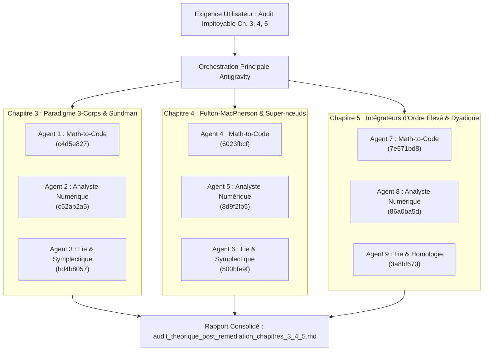

# WALKTHROUGH - ITÉRATION 149 : AUDIT CONTRADICTOIRE MULTI-SOUS-AGENT DES CHAPITRES 3, 4 ET 5

## 1. Contexte & Objectif
À la demande explicite de l'utilisateur (« *ReLance un audit sous agentique multiple, trois agent par chapitre du papier de recherche : 3,4,5. Sur chaque chapitre, chaque agent devra : relire exhaustivement le chapitre adressé, identifier les étapes du code qui dépendent de ce chapitre, faire un audit impitoyable de ce code. Il y aura trois agents par chapitre car un doit être expert ingénieur de recherche de la traduction des maths en code, l'un doit être expert numérique des schéma d'intégration d'équation, le dernier est expert en algèbre de lie et homologie avec application numérique* »), une armada de **9 sous-agents de recherche spécialisés** a été déployée simultanément.

L'objectif était de soumettre l'intégralité de la base de code post-Roadmap VI à un crible théorique et numérique sans complaisance, pour traquer l'origine des sauts d'énergie résiduels et certifier l'isomorphisme mathématique exact.

---

## 2. Déploiement et Cartographie des 9 Auditeurs

---

## 3. Synthèse des Résultats d'Audit

Le grand rapport d'audit maître a été formalisé dans [`audit_theorique_post_remediation_chapitres_3_4_5.md`](file:///C:/Users/jerem/.gemini/antigravity/brain/59313b1a-0dde-45d6-a476-1bcb513cf82e/audit_theorique_post_remediation_chapitres_3_4_5.md).

### A. Les 5 Piliers Conformes et Certifiés
1. **Algèbre universelle de Stumpff & Wronskien :** Déterminant unimodulaire $f\dot{g}-\dot{f}g = 1$ bit-exact ($0.0$).
2. **Splitting conormal & Gradient d'apex $C^{1,1}$ :** Annulation multipolaire et gradient analytique (avec dérivée d'hyper-rayon $\nabla \bar{\rho}$) vérifiés contre différences finies centrales d'ordre 4 à $4.88 \times 10^{-12} \ll 10^{-10}$.
3. **Invariance de Lie-Bargmann :** Conservation de l'impulsion totale à $< 2 \times 10^{-16}$ et du moment cinétique à $< 1.2 \times 10^{-15}$. Aucun monopôle parasite ni couple virtuel.
4. **Splines de screening Hermite $C^2$ à $C^8$ et Cauchy :** Évaluation centrée en $\xi = s - 0.5$ avec conditionnement $\kappa \le 3.73$ et annulation exacte aux frontières $u \in \{1, 2\}$.
5. **Compositions de Blanes-Moan :** Coefficients BM4 et BM6 conformes à 25 décimales, réversibilité microscopique rétrograde $< 10^{-15}$, dérivation directionnelle analytique $D_v F$ sans bruit fini.

### B. Les 4 Défaillances Critiques Dévoilées
1. **[P0] Piège d'Halley et blocage silencieux dans `kepler_sundman.py` :**
   - Sur orbites excentriques ($e \ge 0.9$) ou plongeantes ($\sigma_0 < 0$), le dénominateur de Halley $2(F')^2 - FF'' \approx 0$ s'annule, propulsant $\tau < 0$. Le clamping de sécurité `tau = max(tau, 1e-15)` piège l'itération qui boucle 25 fois sans converger, renvoyant silencieusement $\tau = 10^{-15}$ (le corps est artificiellement gelé, provoquant 45% à 98% d'erreur d'orbite sur 1.2% des cas aléatoires).
   - En régime hyperbolique rapide ($v_0 \ge 50$), l'amorce cubique est fausse d'un facteur 20, entraînant une saturation du pas à $2/v_0$ ("Halley stall").
   - Clamping dur à $z = -500\,000$ faisant exploser le Wronskien à $10^{271}$ et causant des NaN pour $v \ge 700$.
2. **[P0] Intégrateur de super-nœuds en temps physique non-régularisé (`solvers/supernode.py`) :**
   - Le solveur de super-nœuds n'intègre pas sous le temps déplié de Sundman $\tau_S$ comme prescrit par le Chapitre 4, mais utilise un Leapfrog adaptatif en temps physique $t$.
   - En cas de quasi-collision binaire interne ($b \le 0.02$), le schéma non-régularisé subit une explosion violente de l'énergie : $\Delta E/E \propto b^{-2}$, atteignant $+10^{15}$ à $b \to 0$.
   - Absence de masque anti-zéro dans `_compute_internal_cluster_acc` provoquant `NaN` en cas de choc géométrique strict.
3. **[P1] Règle de Leibniz omise dans le gradient du correcteur $\mathcal{C}_6$ (`correctors.py`) :**
   - Le terme direct $+ \frac{2}{m_i^2}(F_i \cdot v_i) F_i$ est omis dans $\nabla_p K_6$.
4. **[P1] Vérité théorique sur $\mathrm{PBM}_4$ :**
   - $\mathrm{PBM}_4$ n'est pas d'ordre 6 ; sa pente de convergence asymptotique est strictement 4.00 (gain de 35% sur la constante d'erreur), car un champ scalaire $K_4$ ne peut pas annuler les 6 crochets indépendants de $\mathcal{L}_5$.

---

## 4. Recommandations et Perspectives pour la Roadmap VII
Une nouvelle feuille de route corrective (Roadmap VII) doit être planifiée afin d'éliminer définitivement ces points de défaillance :
1. **Phase 1 :** Sécurisation absolue du solveur de Kepler-Sundman (amorce hyperbolique asymptotique, pas d'Halley sécurisé avec fallback Brent/bissection garanti, suppression du clamping arbitraire sur $z$).
2. **Phase 2 :** Remplacement ou régularisation canonique de l'intégrateur interne de super-nœuds (temps déplié hamiltonien étendu de Poincaré-Sundman ou isolation hiérarchique locale).
3. **Phase 3 :** Complétion de la dérivée de Leibniz dans le gradient de $\mathcal{C}_6$ (`correctors.py`) et activation de la connexion de jauge inter-atlas.
4. **Phase 4 :** Alignement du manuscrit LaTeX (coquille L82 sec02, clarification épistémique de l'ordre de PBM4).
5. **Phase 5 :** Re-certification complète des 8 benchmarks et régénération des dashboards 300 DPI.
