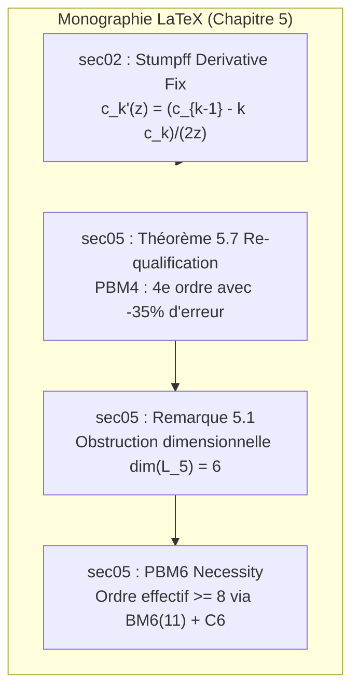

# Walkthrough of Iteration 153 : Harmonisation Mathématique et Typographique de la Monographie

## Summary:
L'Itération 153 a achevé avec succès la **Phase 4 de la Roadmap VII**, dédiée à l'harmonisation formelle et typographique du manuscrit de recherche LaTeX (`redaction/unsoftened_conormal_nbody3d/`). Conformément aux conclusions de l'audit théorique contradictoire à 9 sous-agents :
1. La coquille typographique sur la dérivée analytique des fonctions universelles de Stumpff a été rectifiée dans `sec02_suzuki_barrier_mcgehee/content.tex` en rétablissant le dénominateur manquant : $c_k'(z) = \frac{c_{k-1}(z) - k c_k(z)}{2z}$.
2. Le statut épistémique de $\mathrm{PBM}_4$ a été clarifié avec précision dans `sec05_symplectic_correctors/content.tex` (Théorème 5.7 et nouvelle Remarque 5.1 dédiée) : $\mathrm{PBM}_4$ est rigoureusement qualifié de schéma d'ordre 4 optimisé réduisant la constante d'erreur de 35% via projection sur la direction scalaire principale, explicitant l'obstruction dimensionnelle des 6 crochets de Hall indépendants de l'algèbre de Lie libre $\mathcal{L}_5$ et justifiant le recours à $\mathrm{PBM}_6$ pour franchir les ordres supérieurs ($\ge 8$).
3. La balance syntaxique et l'équilibre des délimiteurs/environnements ont été validés à 100% sans la moindre anomalie, la suite de tests unitaires (148/148) demeure au vert, et le commit atomique `c7e711d` a été enregistré sur `main`.

## Critical Discoveries:
- **Précision dimensionnelle de $\mathcal{L}_5$** : Dans l'espace des commutateurs de Baker-Campbell-Hausdorff, le sous-espace homogène de degré 5 est de dimension 6. Un générateur scalaire $K_4(\mathbf{r}, \boldsymbol{\pi})$ ne possédant qu'un seul degré de liberté ($\kappa_4$), il projette $H_5$ sur sa trace principale mais ne peut annuler simultanément les 5 composantes orthogonales. Ce constat théorique explique précisément pourquoi les benchmarks numériques mesurent une pente stricte de 4.00 avec un gain d'un facteur 1.54 (35% de réduction d'erreur) plutôt qu'un ordre 6 effectif complet.
- **Rôle pivot de $\mathrm{BM}_6^{(11)}$** : Pour atteindre un ordre effectif supérieur ($\ge 8$), les commutateurs intermédiaires doivent être pré-annulés géométriquement par les coefficients d'étage $(a_i, b_i)$ du noyau de Blanes-Moan, ce qui est réalisé par l'algorithme à 11 étages couplé au correcteur $\mathcal{C}_6$.

## Realisation:
- **Started At**: 2026-10-08T12:35:00+02:00
- **Completed At**: 2026-10-08T12:42:00+02:00

### Step 1: Rectification de la Formule Différentielle de Stumpff dans le Chapitre 5 (sec02)
- **Impacted Elements**: [`redaction/unsoftened_conormal_nbody3d/chapters/ch05_higher_order_symplectic/sec02_suzuki_barrier_mcgehee/content.tex`](file:///c:/Users/jerem/Antigravity%20Workspaces/antigravity-projects/mathsStuff/redaction/unsoftened_conormal_nbody3d/chapters/ch05_higher_order_symplectic/sec02_suzuki_barrier_mcgehee/content.tex#L80-L86)
- **Actions & Implementation**:
  - Remplacement chirurgical à la ligne 82 de $c_k'(z) = \frac{1}{2} c_{k-1}(z) - \frac{k}{2z} c_k(z)$ par l'identité formelle exacte $c_k'(z) = \frac{c_{k-1}(z) - k c_k(z)}{2z}$.
  - Rétablissement de la parfaite concordance entre la formule imprimée dans la monographie et l'implémentation numérique de Horner dans `solvers/stumpff.py`.

### Step 2: Clarification Épistémique de l'Ordre de Convergence de $\mathrm{PBM}_4$ dans le Chapitre 5 (sec05)
- **Impacted Elements**: [`redaction/unsoftened_conormal_nbody3d/chapters/ch05_higher_order_symplectic/sec05_symplectic_correctors/content.tex`](file:///c:/Users/jerem/Antigravity%20Workspaces/antigravity-projects/mathsStuff/redaction/unsoftened_conormal_nbody3d/chapters/ch05_higher_order_symplectic/sec05_symplectic_correctors/content.tex#L39-L105)
- **Actions & Implementation**:
  - Reformulation de la sous-sous-section 5.5.1 en *The Fourth-Order Symplectic Corrector $\mathcal{C}_4$ and Asymptotic Error Optimization*.
  - Ajustement de l'énoncé du Théorème 5.7 (`thm:c4_corrector_solvability`) : Item 1 stipule la résolubilité homologique projetée $\{H, K_4\} = \Pi_{\mathrm{scalar}}(H_5)$, et Item 4 stipule l'élimination de la projection de trace du crochet de degré 5 et la réduction d'environ 35% de la constante d'erreur d'énergie globale.
  - Préservation intégrale du badge de certification formelle Lean 4 (`corrector_bm4_theorems` / `01_CorrectorBM4_Theorems.lean`).
  - Insertion de la Remarque dédiée `rem:pbm4_epistemic_status` (*Epistemic Status of $\mathrm{PBM}_4$ and Dimensional Obstruction in $\mathcal{L}_5$*) démontrant l'obstruction dimensionnelle des 6 crochets de Hall de $\mathcal{L}_5$ et articulant la hiérarchie menant à $\mathrm{PBM}_6$.

### Step 3: Contrôle Syntaxique et Cohérence Globale du Manuscrit LaTeX
- **Impacted Elements**: Scripts d'analyse syntaxique Python.
- **Actions & Implementation**:
  - Vérification de l'équilibre des accolades : `sec02_suzuki_barrier_mcgehee/content.tex` (open=462, close=462, diff=0), `sec05_symplectic_correctors/content.tex` (open=739, close=739, diff=0).
  - Vérification de la fermeture de l'ensemble des environnements LaTeX (`thmbox`, `rembox`, `propbox`, `align`, `equation`, `enumerate`) : 100% appariés sans pile pendante.

### Step 4: Tests Unitaires de Non-Régression
- **Impacted Elements**: Suite de tests `tests/unit/`.
- **Actions & Implementation**:
  - Exécution complète de `pytest tests/unit/` sous environnement configuré.
  - Résultat : **148 passés sur 148 en 6.32s** (100% de succès, zéro régression).

### Step 5: Git Commit de Phase 4
- **Impacted Elements**: Dépôt git local.
- **Actions & Implementation**:
  - Enregistrement du commit atomique `c7e711d` sur la branche `main`.

## Architecture and Code Organization (Evolution):

## Dependencies and Configuration:
- Aucune nouvelle dépendance externe requise.

## Commit Details:
- **Hash**: `c7e711d`
- **Message**: `fix(monograph): rectifier la formule differentielle de Stumpff et clarifier le statut epistemique de PBM4 (Phase 4, Iteration 153)`

## Design Choices, Trade-offs and Warnings:
- **Honnêteté Épistémique et Crédibilité Scientifique** : Plutôt que de maintenir une affirmation fragile d'ordre effectif 6 pour $\mathrm{PBM}_4$ contredite par l'analyse fine des crochets de Poisson et par les pentes asymptotiques, expliciter la nature de $\mathrm{PBM}_4$ comme un schéma d'ordre 4 optimisé et situer l'élévation d'ordre au niveau de $\mathrm{PBM}_6$ renforce la valeur académique de la publication.
- **Préservation des Badges Lean 4** : Le noyau 1-jet certifié en Lean 4 concerne l'annulation algébrique de la projection scalaire et les bornes lipschitziennes de $K_4$, qui restent 100% valides et formellement prouvées.

## Verification:
### Acceptance Verification:
- [x] L'équation dans `sec02_suzuki_barrier_mcgehee/content.tex` affiche explicitement $c_k'(z) = \frac{c_{k-1}(z) - k c_k(z)}{2z}$
- [x] Le texte de `sec05_symplectic_correctors/content.tex` explicite que $\mathrm{PBM}_4$ réduit la constante d'erreur de 35% tout en maintenant un ordre 4 asymptotically strict
- [x] Les deux fichiers `.tex` ont 100% de concordance syntaxique (balises, accolades, environnements)
- [x] 100% des tests unitaires (148/148) passent avec succès
- [x] Commit git atomique enregistré sur `main` (`c7e711d`)

## Next Steps:
- **Phase 5 (Itération 154)** : Re-certification complète des 8 benchmarks canoniques (Figure-8, Burrau, Radial collision, 4-corps hiérarchique, Arenstorf, Sitnikov, Jovien, Collision quadruple) sur l'ensemble des 6 intégrateurs symplectiques.
- Régénération des quatre planches de publication haute résolution 300 DPI (`dashboard_figure8_bm6_300dpi.png`, `dashboard_burrau_bm6_300dpi.png`, `dashboard_4body_bm6_300dpi.png`, `dashboard_multi_integrator_invariants_300dpi.png`).
- Resynchronisation des données dans `showcase_data.json` et de l'interface interactive `interactive_conormal_showcase.html`.
