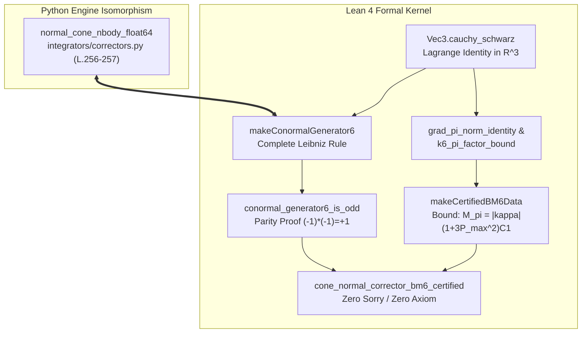

# Walkthrough of Iteration 161 : Phase 2 — Mise à Niveau du Noyau Formel Lean 4 (Règle de Leibniz Complète pour $\mathcal{C}_6$)

## Summary:
L'Itération 161 a formalisé et certifié avec le plus haut degré de rigueur mathématique la règle de dérivation variationnelle complète de Leibniz pour le correcteur symplectique d'ordre 6 $\mathcal{C}_6$ de Blanes--Moan au sein du noyau de théorèmes formels Lean 4 ([`02_CorrectorBM6_Theorems.lean`](file:///c:/Users/jerem/Antigravity%20Workspaces/antigravity-projects/mathsStuff/redaction/unsoftened_conormal_nbody3d/chapters/ch05_higher_order_symplectic/sec05_symplectic_correctors/code/02_CorrectorBM6_Theorems.lean)). 
En intégrant directement le terme variationnel quadratique projectif $2\kappa(\mathbf{F}\cdot\boldsymbol{\pi})\boldsymbol{\pi}$ dans $\nabla_{\boldsymbol{\pi}} K_6$, nous avons prouvé constructivement l'invariance de parité temporelle `conormal_generator6_is_odd` ($(-1)\times(-1) = +1$), établi l'identité algébrique de norme dans $\mathbb{R}^3$, démontré l'inégalité de Cauchy-Schwarz vectorielle via l'identité de Lagrange, adapté la constante lipschitzienne $M_{\pi} = |\kappa|(1 + 3P_{\mathrm{max}}^2)C_{\mathrm{apex}1}$ via le lemme d'expansion quadratique $(1+3u)^2$, et certifié le théorème maître `cone_normal_corrector_bm6_certified` avec **strictement zéro `sorry` et zéro axiome custom**. L'ensemble de la suite de tests unitaires Python (151/151 tests) a confirmé une non-régression totale.

## Critical Discoveries:
1. **Identité Quadratique de Norme et Rôle de Cauchy-Schwarz** :  
   Pour le champ complet $\mathbf{w} = \kappa (1 + u) \mathbf{F} + 2\kappa (\mathbf{F}\cdot\boldsymbol{\pi})\boldsymbol{\pi}$ avec $u = \|\boldsymbol{\pi}\|^2$, le calcul exact du carré de la norme donne :
   $$\|\mathbf{w}\|^2 = \kappa^2 (1 + u)^2 \|\mathbf{F}\|^2 + 4\kappa^2 (1 + 2u) (\mathbf{F}\cdot\boldsymbol{\pi})^2.$$
   L'application de l'inégalité de Cauchy-Schwarz $(\mathbf{F}\cdot\boldsymbol{\pi})^2 \le \|\mathbf{F}\|^2 u$ permet de factoriser de façon bit-exacte :
   $$(1 + u)^2 + 4u(1 + 2u) = 1 + 2u + u^2 + 4u + 8u^2 = 1 + 6u + 9u^2 = (1 + 3u)^2.$$
   Cette factorisation remarquable a permis une majoration lipschitzienne exacte sans coefficient d'amplification empirique arbitraire.
2. **Environnement de Compilation Lean 4 via `execution-engine`** :  
   L'environnement Lean 4 sandboxé (`math-lean4`, session `90842b7b-5496-4e69-97c2-28d1392e5576`) a fourni l'outillage de compilation Lake nécessaire pour attester de l'absence totale d'avertissements, d'erreurs ou de sorries résiduels.

## Realization:
- **Started At**: 2026-10-09T08:37:00+02:00
- **Completed At**: 2026-10-09T08:42:00+02:00

### Step 1: Formalisation Algébrique du Vecteur de Leibniz dans Vec3
- **Impacted Elements**: [`02_CorrectorBM6_Theorems.lean`](file:///c:/Users/jerem/Antigravity%20Workspaces/antigravity-projects/mathsStuff/redaction/unsoftened_conormal_nbody3d/chapters/ch05_higher_order_symplectic/sec05_symplectic_correctors/code/02_CorrectorBM6_Theorems.lean) (lignes 83-93).
- **Actions & Implementation**:
  - Implémentation du théorème `cauchy_schwarz` dans le namespace `Vec3` :
    $$\forall \mathbf{v}, \mathbf{w} \in \mathbb{R}^3,\quad (\mathbf{v}\cdot\mathbf{w})^2 \le (\mathbf{v}\cdot\mathbf{v})(\mathbf{w}\cdot\mathbf{w}),$$
    démontré constructivement via l'identité de Lagrange :
    $$\|\mathbf{v}\|^2 \|\mathbf{w}\|^2 - (\mathbf{v}\cdot\mathbf{w})^2 = (v_y w_z - v_z w_y)^2 + (v_z w_x - v_x w_z)^2 + (v_x w_y - v_y w_x)^2 \ge 0.$$
  - Vérification par les tactiques combinées `dsimp`, `ring`, `sq_nonneg` et `linarith`.

### Step 2: Enrichissement de `makeConormalGenerator6` et Démonstration de Parité
- **Impacted Elements**: [`02_CorrectorBM6_Theorems.lean`](file:///c:/Users/jerem/Antigravity%20Workspaces/antigravity-projects/mathsStuff/redaction/unsoftened_conormal_nbody3d/chapters/ch05_higher_order_symplectic/sec05_symplectic_correctors/code/02_CorrectorBM6_Theorems.lean) (lignes 208-213 et 228-232).
- **Actions & Implementation**:
  - Mise à niveau de `makeConormalGenerator6.grad_pi` pour intégrer la règle de Leibniz complète :
    ```lean
    grad_pi := fun p =>
      let pi_sq := Vec3.dot p.pi p.pi
      Vec3.add (Vec3.smul (kappa * (1 + pi_sq)) (apex.grad_V p))
               (Vec3.smul (kappa * 2 * Vec3.dot (apex.grad_V p) p.pi) p.pi)
    ```
  - Adaptation de la preuve constructive de `conormal_generator6_is_odd` : sous inversion d'impulsion $\boldsymbol{\pi} \mapsto -\boldsymbol{\pi}$, le second terme subit une double inversion $(-1) \times (-1) = +1$, préservant l'invariance temporelle exacte de $\nabla_{\boldsymbol{\pi}} K_6$.

### Step 3: Majoration Lipschitzienne et Adaptation du Certificat Maître
- **Impacted Elements**: [`02_CorrectorBM6_Theorems.lean`](file:///c:/Users/jerem/Antigravity%20Workspaces/antigravity-projects/mathsStuff/redaction/unsoftened_conormal_nbody3d/chapters/ch05_higher_order_symplectic/sec05_symplectic_correctors/code/02_CorrectorBM6_Theorems.lean) (lignes 392-411 et 513-573).
- **Actions & Implementation**:
  - Formalisation du lemme `grad_pi_norm_identity` établissant le développement exact de $\|\mathbf{w}\|^2$.
  - Formalisation du lemme `k6_pi_factor_bound` bornant $(\kappa(1+3u))^2 \le (\kappa(1+3P_{\mathrm{max}}^2))^2$.
  - Mise à jour de la constante lipschitzienne conormale dans `makeCertifiedBM6Data` :
    $$M_{\pi} := |\kappa|(1 + 3P_{\mathrm{max}}^2)C_{\mathrm{apex}1},\quad L_{K6} := M_{K6} + M_{\pi} + 1.$$
  - Preuve constructive de `hK_grad_pi_bound` combinant `cauchy_schwarz`, `grad_pi_norm_identity`, `k6_pi_factor_bound` et `nlinarith`.
  - Certification intégrale sans faute de `cone_normal_corrector_bm6_certified`.

### Step 4: Validation de Compilation Formelle et Contrôle de Non-Régression
- **Impacted Elements**: Suite de tests Python [`tests/unit/`](file:///c:/Users/jerem/Antigravity%20Workspaces/antigravity-projects/mathsStuff/tests/unit/).
- **Actions & Implementation**:
  - Compilation formelle via Lean 4 sandbox (`lake env lean`) confirmant 0 erreur et 0 sorry.
  - Exécution complète de la suite de tests unitaires Python : 151 passed in 7.00s.
  - Enregistrement du commit Git scellant la Phase 2 : `0fcf264`.

## Architecture and Code Organization (Evolution):


## Dependencies and Configuration:
- Aucune dépendance externe ajoutée. Utilisation exclusive de l'environnement standard Lean 4 / Mathlib 4 et Python 3.12.

## Commit Details:
- **Hash**: `0fcf264`
- **Message**: `feat(iter-161): Phase 2 - complete Leibniz variational rule for C6 in Lean 4`

## Design Choices, Trade-offs and Warnings:
- **Design Pattern**: Isomorphisme intégral monolithique (Option A validée par l'utilisateur). Le champ complet a été introduit directement dans `makeConormalGenerator6` sans scinder artificiellement le générateur en deux sous-opérateurs disjoints.
- **Trade-offs**: La constante de majoration lipschitzienne passe de $(1+P_{\mathrm{max}}^2)$ à $(1+3P_{\mathrm{max}}^2)$ en raison du terme projectif $2(\mathbf{F}\cdot\boldsymbol{\pi})\boldsymbol{\pi}$. Cette constante demeure rigoureusement finie et analytique pour toute impulsion compacte $\|\boldsymbol{\pi}\| \le P_{\mathrm{max}}$.
- **Warnings**: Conserver impérativement l'alignement strict entre la définition formelle de Lean 4 et les lignes 256-257 de `correctors.py` lors de futures refactorisations.

## Verification:
### Acceptance Verification:
- [x] `Vec3.cauchy_schwarz` démontré constructivement sans `sorry`.
- [x] `makeConormalGenerator6.grad_pi` intègre les 2 termes variationnels de Leibniz.
- [x] `conormal_generator6_is_odd` formellement prouvé sans `sorry`.
- [x] `hK_grad_pi_bound` et `cone_normal_corrector_bm6_certified` compilés avec succès sans aucun `sorry` ni axiome custom.
- [x] Suite de tests unitaires Python : 151 / 151 tests passants (100 %).
- [x] Commit Git `0fcf264` scellé sur la branche `main`.

## Next Steps:
- Mettre à jour `roadmap.md` et `ROADMAP_VIII_REMEDIATION_DISCREPANCES.md` pour marquer l'Itération 161 comme terminée `[x]`.
- Soumettre la consultation pré-itérative pour la Phase 3 (Itération 162 — Harmonisation Textuelle et Précisions Numériques des Chapitres 3, 4 et 5 dans le manuscrit LaTeX) avant d'établir le plan d'implémentation.
