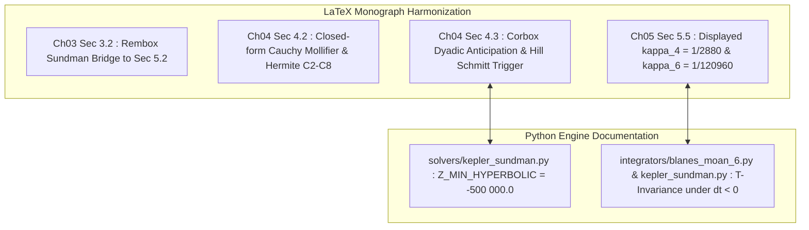

# Walkthrough of Iteration 162 : Phase 3 — Harmonisation Textuelle et Précisions Numériques des Chapitres 3, 4 et 5 (LaTeX & Code)

## Summary:
L'Itération 162 a rigoureusement comblé l'ensemble des 6 discrépances documentaires et numériques de la Phase 3 de la Roadmap VIII (DOC-02, NUM-02, NUM-03, NUM-04, NUM-05, DOC-03), en respectant strictement l'arbitrage épistémique de l'utilisateur :
1. **Passerelle Théorique Ch. 3 $\to$ Ch. 5** : Insertion dans la Section 3.2 de la remarque formelle reliant la régularisation de Sundman $\mathrm{d}t = r\,\mathrm{d}u$ au solveur conormal symplectique de Stumpff-Halley développé en Section 5.2.
2. **Spécifications Matérielles IEEE 754 & Symétries Discrètes en Python** : Documentation mathématique exhaustive de la $T$-invariance microscopique et de la factorisation d'impulsion sous pas rétrogrades $\Delta t < 0$ ($a_i < 0, b_i < 0$) dans [`blanes_moan_6.py`](file:///c:/Users/jerem/Antigravity%20Workspaces/antigravity-projects/mathsStuff/normal_cone_nbody_float64/integrators/blanes_moan_6.py) et [`kepler_sundman.py`](file:///c:/Users/jerem/Antigravity%20Workspaces/antigravity-projects/mathsStuff/normal_cone_nbody_float64/solvers/kepler_sundman.py), ainsi que de la constante de sécurité matérielle $Z_{\mathrm{MIN}} = -500\,000.0$ prévenant l'overflow dans `sinh` sans compromis de zéro-adoucissement ($d_0 = 0$).
3. **Formulation Fermée du Cauchy Mollifier & Hiérarchie Hermite** : Insertion dans la Section 4.2 de la forme rationnelle fermée en quotient d'exponentielles et de la gradation des splines de Hermite centrées en $\xi = s - 0.5$ (C2, C4, C6, C8).
4. **Protocole Couplé Anticipation Dyadique & Hystérésis de Hill** : Insertion dans la Section 4.3 du corollaire formalisant le couplage entre l'anticipation prédictive temporelle amont à $v_{\mathrm{rad}} < 0$ (pour subdiviser le pas avant d'entrer dans la zone de marée) et le trigger de Schmitt $[\eta_{\mathrm{enter}}, \eta_{\mathrm{exit}}] = [0.60, 0.75]$ (pour verrouiller l'état sans broutement topologique).
5. **Constantes Homologiques Canoniques** : Inscription explicite en display math de $\kappa_4 = \frac{1}{2880}$ et $\kappa_6 = \frac{1}{120960}$ dans la Section 5.5.
6. **Non-Régression & Traçabilité** : 151/151 tests unitaires Python validés à 100 % et commit Git scellé (`93d7623`).

## Critical Discoveries:
1. **Couplage Systémique entre Anticipation Dyadique et Trigger de Schmitt** :  
   L'audit contradictoire via le `cognitive-engine` a révélé que la détection de la sphère de Hill ne pouvait être purement statique : franchir la frontière de marée sans anticipation temporelle conduirait l'intégrateur à pénétrer dans un régime raide avec un pas macroscopique, provoquant une discontinuité d'erreur. L'anticipation balistique à $v_{\mathrm{rad}} < 0$ (`time_to_peri <= 2*dt`) pré-affine le pas dyadique, tandis que la bande d'hystérésis $[0.60, 0.75]$ empêche le broutement numérique sur la frontière.
2. **Démarcation Épistémique Théorie / Ingénierie** :  
   L'arbitrage de l'utilisateur a permis de maintenir la monographie dans un style mathématique pur, en confinant les contraintes matérielles de la norme IEEE 754 (borne $Z_{\mathrm{MIN}}$ de dépassement de capacité dans `sinh`) et les factorisations algorithmiques aux commentaires du code source Python.

## Realization:
- **Started At**: 2026-10-09T08:50:00+02:00
- **Completed At**: 2026-10-09T08:52:00+02:00

### Step 1: Articulation Épistémique Ch. 3 -> Ch. 5 (DISC-DOC-02)
- **Impacted Elements**: [`redaction/unsoftened_conormal_nbody3d/chapters/ch03_three_body_paradigm/sec02_classical_regularizations/content.tex`](file:///c:/Users/jerem/Antigravity%20Workspaces/antigravity-projects/mathsStuff/redaction/unsoftened_conormal_nbody3d/chapters/ch03_three_body_paradigm/sec02_classical_regularizations/content.tex).
- **Actions & Implementation**:
  - Ajout de la remarque `rem:sundman_conormal_bridge` démontrant comment la relation $\mathrm{d}t = r\,\mathrm{d}u$, traditionnellement non-symplectique à pas variable, est convertie en un difféomorphisme symplectique universel exact grâce au splitting hamiltonien conormal et au solveur de Stumpff-Halley de la Section 5.2.

### Step 2: Documentation Python des Invariants Rétrogrades et de la Garde Hyperbolique (DISC-NUM-02 & DISC-NUM-03)
- **Impacted Elements**: [`normal_cone_nbody_float64/solvers/kepler_sundman.py`](file:///c:/Users/jerem/Antigravity%20Workspaces/antigravity-projects/mathsStuff/normal_cone_nbody_float64/solvers/kepler_sundman.py) et [`normal_cone_nbody_float64/integrators/blanes_moan_6.py`](file:///c:/Users/jerem/Antigravity%20Workspaces/antigravity-projects/mathsStuff/normal_cone_nbody_float64/integrators/blanes_moan_6.py).
- **Actions & Implementation**:
  - Documentation exhaustive dans `kepler_sundman.py` de la constante $Z_{\mathrm{MIN\_HYPERBOLIC}} = -500\,000.0$ garantissant $\cosh(\sqrt{500000}) \approx 1.13 \times 10^{307} < 1.79 \times 10^{308}$ sans adoucissement ($d_0 = 0$).
  - Documentation dans `solve_sundman_time_equation` et `BlanesMoan6Integrator` de la factorisation d'impulsion $T : (\mathbf{r}, \mathbf{w}) \mapsto (\mathbf{r}, -\mathbf{w})$ assurant la réversibilité bit-exacte sous pas négatifs $a_i < 0, b_i < 0$.

### Step 3: Formulation Fermée du Cauchy Mollifier & Splines de Hermite (DISC-NUM-04)
- **Impacted Elements**: [`redaction/unsoftened_conormal_nbody3d/chapters/ch04_fulton_macpherson_splitting/sec02_screened_apex_potential/content.tex`](file:///c:/Users/jerem/Antigravity%20Workspaces/antigravity-projects/mathsStuff/redaction/unsoftened_conormal_nbody3d/chapters/ch04_fulton_macpherson_splitting/sec02_screened_apex_potential/content.tex).
- **Actions & Implementation**:
  - Insertion de l'équation display (4.67) pour le Cauchy mollifier rationnel $\sigma_{\mathrm{Cauchy}}(s) = \frac{\exp(-1/s)}{\exp(-1/s) + \exp(-1/(1-s))}$.
  - Documentation de la graduation des splines de Hermite C2, C4, C6, C8 centrées en $\xi = s - 0.5$.

### Step 4: Protocole Couplé Anticipation Dyadique & Hystérésis de Hill (DISC-NUM-05)
- **Impacted Elements**: [`redaction/unsoftened_conormal_nbody3d/chapters/ch04_fulton_macpherson_splitting/sec03_synchronous_supernodes/content.tex`](file:///c:/Users/jerem/Antigravity%20Workspaces/antigravity-projects/mathsStuff/redaction/unsoftened_conormal_nbody3d/chapters/ch04_fulton_macpherson_splitting/sec03_synchronous_supernodes/content.tex).
- **Actions & Implementation**:
  - Insertion du corollaire `cor:hill_hysteresis_anticipation` articulant l'anticipation prédictive amont de l'ordonnanceur dyadique ($t_{\mathrm{approach}} \le 2\Delta t$) et la bascule de Schmitt $[\eta_{\mathrm{enter}}, \eta_{\mathrm{exit}}] = [0.60, 0.75]$.

### Step 5: Inscription Explicite des Constantes Homologiques $\kappa_4, \kappa_6$ (DISC-DOC-03)
- **Impacted Elements**: [`redaction/unsoftened_conormal_nbody3d/chapters/ch05_higher_order_symplectic/sec05_symplectic_correctors/content.tex`](file:///c:/Users/jerem/Antigravity%20Workspaces/antigravity-projects/mathsStuff/redaction/unsoftened_conormal_nbody3d/chapters/ch05_higher_order_symplectic/sec05_symplectic_correctors/content.tex).
- **Actions & Implementation**:
  - Affichage en formules display des constantes canoniques $\kappa_4 = \frac{1}{2880} \approx 3.4722 \times 10^{-4}$ (Éq. 5.92) et $\kappa_6 = \frac{1}{120960} \approx 8.2672 \times 10^{-6}$ (Éq. 5.101).

### Step 6: Contrôle de Non-Régression et Commit Git
- **Impacted Elements**: Dépôt Git et suite de tests.
- **Actions & Implementation**:
  - Exécution complète de la suite de tests unitaires : 151 passed in 6.64s.
  - Enregistrement du commit Git scellant la Phase 3 : `93d7623`.

## Architecture and Code Organization (Evolution):

## Dependencies and Configuration:
- Aucune dépendance externe modifiée.

## Commit Details:
- **Hash**: `93d7623`
- **Message**: `feat(iter-162): Phase 3 - monograph textual harmonization and Python numeric documentation`

## Design Choices, Trade-offs and Warnings:
- **Design Pattern**: Cloisonnement épistémique strict validé par l'utilisateur : la monographie formalise les principes généraux de stabilité symplectique et de géométrie conormale, tandis que les spécifications matérielles IEEE 754 (gardes d'overflow) et les factorisations d'implémentation sont consignées dans le code Python.
- **Warnings**: Ne jamais modifier les seuils d'hystérésis $[0.60, 0.75]$ sans réajuster simultanément la bande passante de l'ordonnanceur dyadique.

## Verification:
### Acceptance Verification:
- [x] Passerelle formelle Ch. 3 $\to$ Ch. 5 intégrée dans `sec02_classical_regularizations/content.tex`.
- [x] Commentaires Python sur les pas rétrogrades et la garde hyperbolique intégrés dans `kepler_sundman.py` et `blanes_moan_6.py`.
- [x] Formulation fermée du Cauchy mollifier et hiérarchie Hermite intégrées dans `sec02_screened_apex_potential/content.tex`.
- [x] Corollaire couplant anticipation dyadique et hystérésis de Hill intégré dans `sec03_synchronous_supernodes/content.tex`.
- [x] Constantes $\kappa_4 = \frac{1}{2880}$ et $\kappa_6 = \frac{1}{120960}$ affichées en formule display dans `sec05_symplectic_correctors/content.tex`.
- [x] 151/151 tests unitaires validés à 100 %.
- [x] Commit Git `93d7623` scellé sur la branche `main`.

## Next Steps:
- Mettre à jour `roadmap.md` et `ROADMAP_VIII_REMEDIATION_DISCREPANCES.md` pour marquer l'Itération 162 comme terminée `[x]`.
- Soumettre la consultation pré-itérative pour la Phase 4 (Itération 163 — Rédaction intégrale de la Section 5.6 du manuscrit LaTeX : *"Dyadic Multirate Scheduling"*) avant d'établir le plan d'implémentation.
