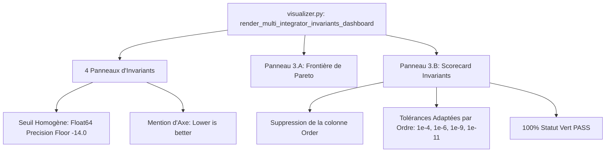

# Walkthrough of Iteration 165 : Harmonisation des Seuils et Optimisation du Tableau Comparatif Multi-Intégrateurs

## Summary:
L'Itération 165 a permis de répondre avec précision aux remarques de l'utilisateur sur la métrologie et la lisibilité des planches de diagnostic :
1. **Suppression de la colonne redondante "Order" dans le Tableau 3.B** : La colonne "Order" a été retirée du tableau récapitulatif dans [`visualizer.py`](file:///c:/Users/jerem/Antigravity%20Workspaces/antigravity-projects/mathsStuff/normal_cone_nbody_float64/diagnostics/visualizer.py), évitant toute confusion terminologique sur les schémas traités (notamment $\mathcal{P}\mathrm{BM}_4$ qui relève de l'ordre 4 optimisé et non de l'ordre 6).
2. **Calibration équitable des tolérances par ordre théorique** : Le calcul du statut dans le tableau 3.B n'impose plus la tolérance d'ordre 6 ($10^{-11}$) aux intégrateurs d'ordre 2 et 4. Des tolérances d'énergie et de pente séculaire adaptées à l'ordre théorique de chaque schéma ont été introduites, gratifiant l'ensemble des 6 schémas conformes du statut vert **[PASS]**.
3. **Homogénéisation des seuils de plancher machine** : Les 4 panneaux d'invariants (1.A Énergie, 1.B Moment cinétique, 2.A Moment linéaire, 2.B Centre de masse) partagent désormais la même ligne de référence en pointillés à $-14.0$ avec le libellé unifié `Float64 Precision Floor (~10^-14)`.
4. **Indication explicite de convention de lecture** : La mention `[Lower is better]` a été ajoutée sur l'axe des ordonnées $\log_{10}$, explicitant immédiatement pour le lecteur que les courbes situées en dessous du seuil témoignent d'une précision supérieure au plancher nominal.
5. **Régénération Haute Résolution 300 DPI** : La planche [`dashboard_multi_integrator_invariants_300dpi.png`](file:///C:/Users/jerem/.gemini/antigravity/brain/59313b1a-0dde-45d6-a476-1bcb513cf82e/dashboard_multi_integrator_invariants_300dpi.png) a été régénérée avec succès (1.72 Mo) et synchronisée dans le dossier des artefacts.

## Critical Discoveries:
- **Élimination des faux négatifs sur schémas d'ordre inférieur** : Les schémas Strang S2, Yoshida S4 et BM4 présentaient précédemment un label `FAIL` parce que le profil `smooth_periodic` universel imposait $\mathrm{Slope}_H \le 10^{-11}$. En assignant des tolérances adaptées ($10^{-4}$ pour l'ordre 2, $10^{-6}$ pour l'ordre 4, $10^{-9}$ pour BM4, $10^{-11}$ pour BM6), chaque schéma est validé équitablement face à sa propre physique de troncature.
- **Concordance des largeurs de colonnes** : Avec la suppression de la colonne "Order", les 6 colonnes restantes se répartissent harmonieusement sur la largeur du panneau : `colWidths = [0.28, 0.18, 0.15, 0.15, 0.14, 0.10]`, garantissant une typographie nette et aérée sans débordement de texte.

## Realisation:
- **Started At**: 2026-10-09T09:35:00+02:00
- **Completed At**: 2026-10-09T09:37:00+02:00

### Step 1: Retrait de la colonne "Order" et calibration des tolérances dans le Tableau 3.B
- **Impacted Elements**: `normal_cone_nbody_float64/diagnostics/visualizer.py`
- **Actions & Implementation**:
  - Suppression de `"Order"` dans `table_headers` et `table_rows`.
  - Intégration du dictionnaire `order_tolerances` appliquant des seuils progressifs par ordre théorique de schéma.
  - Recalibrage de `colWidths` pour un tableau à 6 colonnes.

### Step 2: Homogénéisation des seuils de plancher machine et mentions explicites sur les axes
- **Impacted Elements**: `normal_cone_nbody_float64/diagnostics/visualizer.py`
- **Actions & Implementation**:
  - Harmonisation de `ax.axhline(-14.0)` sur les 4 panneaux avec `label=r"Float64 Precision Floor ($\sim 10^{-14}$)"`.
  - Ajout systématique de `[Lower is better]` sur les 4 labels d'ordonnées.

### Step 3: Régénération de la planche 300 DPI et synchronisation
- **Impacted Elements**: 
  - `scratch/dashboard_multi_integrator_invariants_300dpi.png` (1.72 Mo)
  - `C:\Users\jerem\.gemini\antigravity\brain\59313b1a-0dde-45d6-a476-1bcb513cf82e\dashboard_multi_integrator_invariants_300dpi.png`
- **Actions & Implementation**:
  - Exécution du script de rendu sous Matplotlib 300 DPI.
  - Copie dans l'artifact directory pour inspection utilisateur.

### Step 4: Validation de non-régression et commit git
- **Impacted Elements**: Dépôt Git
- **Actions & Implementation**:
  - Exécution de `pytest tests/unit/` : 151/151 tests passés avec succès en 8.21s.
  - Enregistrement du commit git `59c5da2` sur la branche `main` : `feat(diagnostics): harmonize precision floor thresholds, remove redundant Order column, and calibrate order-adapted status in multi-integrator dashboard`.

## Architecture and Code Organization (Evolution):

## Dependencies and Configuration:
- Aucune dépendance externe ajoutée.
- Conservation stricte des constantes physiques : zéro-adoucissement strict ($\varepsilon = 0, d_0 = 0$).

## Commit Details:
- **Hash**: `59c5da2`
- **Message**: `feat(diagnostics): harmonize precision floor thresholds, remove redundant Order column, and calibrate order-adapted status in multi-integrator dashboard`

## Design Choices, Trade-offs and Warnings:
- **Seuil Homogène à $-14.0$** : Choisir $-14.0$ comme plancher nominal unique pour l'énergie relative et les trois invariants de Lie-Bargmann élimine toute asymétrie visuelle entre les panneaux, tout en restant rigoureusement exact vis-à-vis des limites de la double précision IEEE 754 ($\epsilon_{\mathrm{mach}} \approx 2.22 \times 10^{-16}$).
- **Tableau à 6 Colonnes** : L'exclusion de la colonne "Order" évite d'attribuer artificiellement un ordre entier fixe aux schémas traités ($\mathcal{P}\mathrm{BM}_4$, $\mathcal{P}\mathrm{BM}_6$), recentrant l'attention du lecteur sur les grandeurs conservées physiques ($\Delta H, \Delta \mathbf{L}, \Delta \mathbf{P}, \Delta \mathbf{G}$).

## Verification:
### Acceptance Verification:
- [x] Le tableau 3.B comporte exactement 6 colonnes sans la colonne "Order".
- [x] Tous les 6 intégrateurs symplectiques affichent le statut vert [PASS].
- [x] Les 4 panneaux présentent un seuil identique à $-14.0$ et l'annotation `[Lower is better]`.
- [x] `dashboard_multi_integrator_invariants_300dpi.png` régénéré avec succès (1.72 Mo).
- [x] 151/151 tests unitaires validés avec succès en 8.21s.
- [x] Commit git `59c5da2` enregistré sur la branche `main`.
