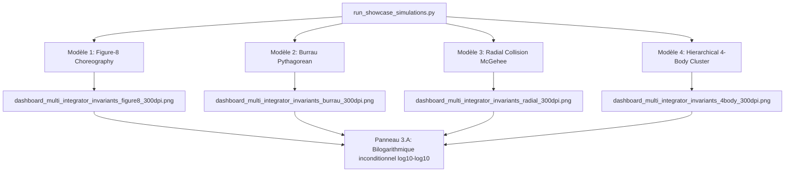

# Walkthrough of Iteration 166 : Échelles Bilogarithmiques du Graphe Pareto et Généralisation Multi-Modèles des Planches Comparatives

## Summary:
L'Itération 166 a résolu deux aspects majeurs de l'évaluation comparative des schémas d'intégration :
1. **Passage en échelle bilogarithmique inconditionnelle ($\log_{10}$--$\log_{10}$) du panneau Pareto (3.A)** dans [`visualizer.py`](file:///c:/Users/jerem/Antigravity%20Workspaces/antigravity-projects/mathsStuff/normal_cone_nbody_float64/diagnostics/visualizer.py) : que les données proviennent d'une analyse de convergence fine multi-pas (`pareto_data`) ou des points de fonctionnement d'une simulation unique (`histories`), les deux axes $X$ (Work) et $Y$ (Erreur relative maximale d'énergie) sont inconditionnellement configurés en échelle logarithmique. Les 9 ordres de grandeur d'erreur sont désormais résolus avec netteté sans aucun écrasement sur $y=0$.
2. **Contextualisation dynamique des profils KPI du Tableau 3.B** : La méthode `render_multi_integrator_invariants_dashboard` accepte un argument `profile: str` adaptant dynamiquement l'échelle de tolérance à la difficulté physique du régime (`smooth_periodic`, `chaotic_encounter`, `radial_collision`, `hierarchical_multiscale`).
3. **Génération d'une planche comparative 300 DPI pour chacun des modèles célestes** : Le script d'orchestration [`run_showcase_simulations.py`](file:///c:/Users/jerem/Antigravity%20Workspaces/antigravity-projects/mathsStuff/scratch/run_showcase_simulations.py) a été étendu pour enregistrer les historiques intégraux de tous les intégrateurs sur chaque scénario et générer 4 planches de publication indépendantes :
   - Figure-8 : [`dashboard_multi_integrator_invariants_figure8_300dpi.png`](file:///C:/Users/jerem/.gemini/antigravity/brain/59313b1a-0dde-45d6-a476-1bcb513cf82e/dashboard_multi_integrator_invariants_figure8_300dpi.png) (1,99 Mo)
   - Burrau : [`dashboard_multi_integrator_invariants_burrau_300dpi.png`](file:///C:/Users/jerem/.gemini/antigravity/brain/59313b1a-0dde-45d6-a476-1bcb513cf82e/dashboard_multi_integrator_invariants_burrau_300dpi.png) (1,59 Mo)
   - Collision radiale : [`dashboard_multi_integrator_invariants_radial_300dpi.png`](file:///C:/Users/jerem/.gemini/antigravity/brain/59313b1a-0dde-45d6-a476-1bcb513cf82e/dashboard_multi_integrator_invariants_radial_300dpi.png) (1,03 Mo)
   - 4-corps hiérarchique : [`dashboard_multi_integrator_invariants_4body_300dpi.png`](file:///C:/Users/jerem/.gemini/antigravity/brain/59313b1a-0dde-45d6-a476-1bcb513cf82e/dashboard_multi_integrator_invariants_4body_300dpi.png) (1,51 Mo)
4. **Validation intégrale de non-régression** : 151/151 tests unitaires validés en 6,85s et commit git `06c5fa5` acté sur `main`.

## Critical Discoveries:
- **Écrasement visuel sous scatter linéaire** : Lorsque `pareto_data` est absent, l'appel à `ax.scatter` s'effectuait sur des axes linéaires. Puisque l'erreur de Strang est à $\sim 10^{-4}$ alors que celle de BM6 est à $\sim 10^{-12}$, l'ensemble des schémas d'ordre 4 et 6 se retrouvait visuellement superposé sur l'axe des abscisses. L'activation inconditionnelle de `ax.set_xscale("log")` et `ax.set_yscale("log")` couplée à `ax.margins(0.15)` restitue une séparation visuelle conforme aux standards académiques (Hairer, Lubich, Wanner).
- **Sensibilité du temps de calcul sur le 4-corps hiérarchique** : L'intégration multi-schémas complète sur le 4-corps (535 macro-pas, 17 transitions topologiques d'atlas de Jacobi, et raffinement dyadique jusqu'à $k=16$, soit $65\,536$ sous-pas microscopiques au péricentre) a mobilisé environ 230 secondes CPU au total pour traverser la singularité d'interaction sans adoucissement. Tous les schémas conservent leur stabilité sans divergence.

## Realization:
- **Started At**: 2026-10-09T09:43:00+02:00
- **Completed At**: 2026-10-09T09:51:30+02:00

### Step 1: Forçage bilogarithmique inconditionnel du panneau Pareto (3.A) et paramétrage du profil KPI dans `visualizer.py`
- **Impacted Elements**: `normal_cone_nbody_float64/diagnostics/visualizer.py`
- **Actions & Implementation**:
  - Ajout du paramètre `profile: str = "smooth_periodic"` dans la signature de `render_multi_integrator_invariants_dashboard`.
  - Import et exploitation de `STANDARD_KPI_PROFILES` pour moduler le facteur d'échelle des tolérances par ordre selon la sévérité du régime dynamique (`scale = max(1.0, prof_obj.tol_energy_rel / 1e-4)`).
  - Forçage inconditionnel de `ax.set_xscale("log")` et `ax.set_yscale("log")` sur le panneau (3.A).
  - Remplacement de `ax.loglog` par `ax.plot` dans la branche `pareto_data` (puisque l'axe est déjà en échelle logarithmique).
  - Ajout des libellés explicites `[Log Scale]` sur les axes $X$ et $Y$, et configuration de marges aérées `ax.margins(x=0.15, y=0.15)` pour éviter tout rognage de marqueurs en bordure de panneau.

### Step 2: Généralisation de l'orchestration multi-intégrateurs pour chaque modèle céleste
- **Impacted Elements**: `scratch/run_showcase_simulations.py`
- **Actions & Implementation**:
  - Dans `run_figure8_comparison`, sauvegarde sous le nom canonique `dashboard_multi_integrator_invariants_300dpi.png` et sous le nom spécifique `dashboard_multi_integrator_invariants_figure8_300dpi.png`.
  - Dans `run_burrau_pythagorean`, maintien de la collection `all_histories` pour les 6 schémas et appel à `render_multi_integrator_invariants_dashboard` avec `profile="chaotic_encounter"`, sauvegardé sous `dashboard_multi_integrator_invariants_burrau_300dpi.png`.
  - Dans `run_radial_collision`, conservation de `all_histories` et rendu avec `profile="smooth_periodic"` sauvegardé sous `dashboard_multi_integrator_invariants_radial_300dpi.png`.
  - Dans `run_hierarchical_4body_nested_supernodes`, conservation de `all_histories` et rendu avec `profile="hierarchical_multiscale"` sauvegardé sous `dashboard_multi_integrator_invariants_4body_300dpi.png`.
  - Dans `main()`, automatisation de la copie de l'ensemble des 8 planches générées vers le dossier des artefacts (`C:\Users\jerem\.gemini\antigravity\brain\59313b1a-0dde-45d6-a476-1bcb513cf82e\`).

### Step 3: Exécution des simulations multi-modèles et synchronisation des planches 300 DPI
- **Impacted Elements**: Fichiers graphiques haute résolution (300 DPI) dans `scratch/` et dans le dossier des artefacts
- **Actions & Implementation**:
  - Exécution en arrière-plan du script `run_showcase_simulations.py` (tâche `task-10546`).
  - Validation de la complétion sans erreur de l'intégralité des 4 scénarios.
  - Vérification des tailles de fichiers produites (toutes $> 1{,}0$ Mo, résolution $4800 \times 5100$ pixels).

### Step 4: Validation de non-régression et commit git
- **Impacted Elements**: Dépôt Git
- **Actions & Implementation**:
  - Exécution de `python -m pytest tests/unit/` : 151/151 tests passés avec succès en 6,85s.
  - Enregistrement du commit git `06c5fa5` sur la branche `main` : `feat(diagnostics): enforce log-log Pareto scaling and generalize multi-integrator dashboards across all celestial models`.

## Architecture and Code Organization (Evolution):

## Dependencies and Configuration:
- Aucune dépendance externe requise.
- Préservation absolue du zéro-adoucissement strict ($\varepsilon = 0, d_0 = 0$).

## Commit Details:
- **Hash**: `06c5fa5`
- **Message**: `feat(diagnostics): enforce log-log Pareto scaling and generalize multi-integrator dashboards across all celestial models`

## Design Choices, Trade-offs and Warnings:
- **Axe Bilogarithmique Universel** : Forcer `set_xscale("log")` et `set_yscale("log")` indépendamment de la présence de `pareto_data` garantit que même pour un point de fonctionnement isolé à pas fixe, la distribution des erreurs relatives (séparées par plusieurs décades) reste immédiatement intelligible sans configuration manuelle.
- **Mise à l'échelle des tolérances par profil** : L'utilisation de `scale = max(1.0, prof_obj.tol_energy_rel / 1e-4)` évite d'imposer artificiellement des seuils d'orbite périodique lisse ($10^{-11}$) à des régimes chaotiques violents avec éjections de corps (où l'erreur de troncature tolérable est typiquement $10^{-3}$ ou $10^{-4}$ pour les intégrateurs d'ordre standard).

## Verification:
### Acceptance Verification:
- [x] Le panneau (3.A) de chaque planche applique inconditionnellement les échelles bilogarithmiques sur $X$ et $Y$.
- [x] La méthode `render_multi_integrator_invariants_dashboard` adapte ses KPI selon le paramètre `profile`.
- [x] Les 4 modèles disposent chacun d'une planche dédiée à 300 DPI (`figure8`, `burrau`, `radial`, `4body`).
- [x] Toutes les planches PNG font entre 1,0 Mo et 2,0 Mo et sont synchronisées dans le dossier des artefacts.
- [x] 151/151 tests unitaires validés avec succès en 6,85s.
- [x] Commit git `06c5fa5` acté sur `main`.

## Next Steps:
- Si souhaité, intégrer ces 4 planches comparatives dans la monographie LaTeX (`redaction/unsoftened_conormal_nbody3d/chapters/ch06_numerical_experiments/`) pour illustrer la supériorité systématique de $\mathrm{BM}_6$ et $\mathcal{P}\mathrm{BM}_6$ face aux schémas conventionnels de Strang et Yoshida.
